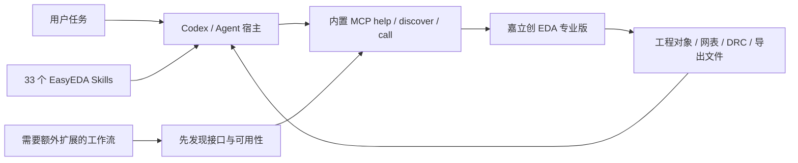

# EasyEDA

面向 Agent 宿主的 **EasyEDA** 插件，版本 `0.1.0-dev.20261019.6`。使用嘉立创 EDA / EasyEDA 专业版客户端的**内置 MCP**，携带独立 `easyeda-skills` 源包的 33 个自包含技能快照。`displayName` 为 `EasyEDA`。

当前为开发候选，源码托管在 [full-aigc-plugins/easyeda-plugin](https://github.com/full-aigc-plugins/easyeda-plugin)，已在本机 Codex 安装验证；尚未创建正式 Release。本包不是 EDA 内部的 `.eext`；官方 Run API Gateway 不是默认依赖。



## 本地使用

在宿主的本地插件导入入口选择本目录；Codex marketplace 文件位于 `.agents/plugins/marketplace.json`，source 使用插件根目录相对路径 `./`。本插件已通过官方 `codex plugin add` 安装到本机 Codex，当前版本 0.1.0-dev.20261019.6，读回 installed=true、enabled=true；含 33 个技能和 1 个内置 MCP。Claude/ZCode 实际加载未验证。

不同宿主的入口分别是 `.codex-plugin/plugin.json`、`.claude-plugin/plugin.json` 与 `.zcode-plugin/plugin.json`。根 `plugin.json` 和 `mcp.json` 使用 Agent Plugins 1.0.0 portable 结构。原生宿主配置保留各自的 MCP transport 写法，不把 portable type 直接复制到所有宿主。

### 先只读检查

```bash
python3 -B skills/easyeda-mcp-setup/scripts/native_mcp.py doctor
python3 -B skills/easyeda-mcp-setup/scripts/native_mcp.py current-project
```

在插件根目录执行；服务地址默认 `http://127.0.0.1:31637/mcp`。专业版需支持原生 MCP（官方说明 4.1.60+）。macOS 如需显式启动，执行 `.../native_mcp.py start`，使用已安装客户端的 LaunchServices；不安装软件、不调整系统权限。

如需其他本机地址，统一修改宿主配置：

```bash
python3 -B scripts/configure_endpoint.py http://127.0.0.1:31638/mcp
```

该命令仅修改本包的三个配置，不修改 Codex 全局设置，也不会启动或验证该端口的服务。诊断时需同时传入 `--endpoint`。不得重复连接两个名字不同但实际相同的原生服务。

## 技能覆盖

五项官方技能适配：API、原理图网络扇出、eprj3 工程、格式、扩展开发。其余 28 项覆盖原理图、网表、器件库、模块复用、布局、布线/Freerouting/KiRouting、规则、DRC/DFM、仿真、电源/时序、丝印/特殊 PCB、制造包/BOM、机械协同、迁移备份、datasheet、知识库和文档。

以 `easyeda-use` 选择工作流；完整任务使用 `easyeda-end-to-end`。每项技能含输入、执行步骤、完成判据、关键风险、具体查询入口和固定上游来源。[全部来源映射](docs/source-analysis.md)；机器目录见 [catalog.json](catalog.json)。

## 快照与打包

技能的唯一维护源是独立 easyeda-skills 包。本包没有兄弟仓库符号链接。

```bash
python3 -B scripts/validate_package.py
python3 -B -m unittest discover -s tests -v
python3 -B scripts/build_package.py
```

ZIP 写入 dist，包含隐藏的宿主配置，排除 .local、缓存与 Git 数据。CRC 与解压后的配置/快照应再次检查。更新技能时显式运行：

```bash
python3 -B scripts/sync_skills.py --source /绝对路径/easyeda-skills
python3 -B scripts/sync_skills.py --source /绝对路径/easyeda-skills --check
```

同步先检测全部冲突，保护人工改动；遇到冲突先在源包合并，不自动覆盖。源码仓库已创建；当前以 main 分支提供开发版本，尚未创建版本标签或正式 Release。

## 验证边界

本地技能/快照检查与组织 PAPR 检查通过；Codex 插件已安装启用，EDA 内部扩展也已安装。
独立 LED 测试已真实完成原理图创建/连线、网表核对、PCB 同步、3/3 网络布线、严格 DRC、保存重开及 Gerber/BOM/坐标导出；详见 [全流程验收](docs/full-flow-validation.md)。原用户工程没有写入。

验收仅覆盖该低压测试电路。部分步骤使用官方原生 API 和客户端确认窗口。未做制造商在线 DFM、实物打样/电测、生产下单；Claude/ZCode 实际加载与其他板型尚未验收。

## 许可

原创适配 Apache-2.0；官方图标保持原样，来源和摘要见 [品牌来源](docs/brand-source.json)。上游固定修订及许可依据见 source-lock.json 与 NOTICE。不是嘉立创官方发行或背书产品。

## 可选高级 MCP

配套 EDA 内部扩展 EasyEDA MCP 提供 14 个领域接口，默认只读；安装包位于 extensions/，来源与摘要见 docs/eda-extension.json。它通过同一个客户端内置 MCP 暴露 external.easyedaMcp，不额外启动服务。安装仍由用户明确授权后导入 EDA 扩展管理器。先用 easyeda-extension-use 技能发现和读取，写入和导出已在独立 LED 及快速入门 Demo 验证；其他板型仍需单独验收。

## 从 GitHub 安装到 Codex

```bash
codex plugin marketplace add full-aigc-plugins/easyeda-plugin
codex plugin add easyeda@full-aigc-plugins-easyeda
```

随包保留 extensions/ 中配套 .eext 安装包；开发依赖、缓存、构建 dist 和本机检查回执不提交。独立测试工程及制造输出保留在本地 easyeda-mcp/artifacts/，不随源码仓库提交。

## 完整官方技能资源

版本 0.1.0-dev.20261019.6 已实际携带 5 个官方技能的完整原文、原版脚本、297 个独立 Schema、291 份图元说明、302 份格式样例及 API/扩展开发参考；eprj3 技能还包含自己的完整格式依赖。总计 9 份固定来源快照、2,769 个文件（格式依赖独立携带，所以物理 Schema 副本共 594 个）。

资源位于各对应技能的 upstream/；中文入口通过 references/bundled-official.md 定位。逐文件修订与摘要见 [official-assets.json](official-assets.json)。快照由 easyeda-skills 同步，不能在本仓库单独改写上游文件。

内置 MCP 配置保持原样。原版 Bridge 源码仅为来源参考，不启动、不配置第二个服务。格式依赖通过技能内 scripts/validate_format.py 的显式 --install-deps 安装到可写缓存，不写入插件资源目录。

新版离线工具、Schema、安装与原生 MCP 验收见 [官方资源验收](docs/official-assets-validation.md)。本次资源补齐不代表 97 个官方插件全部安装或实测。
